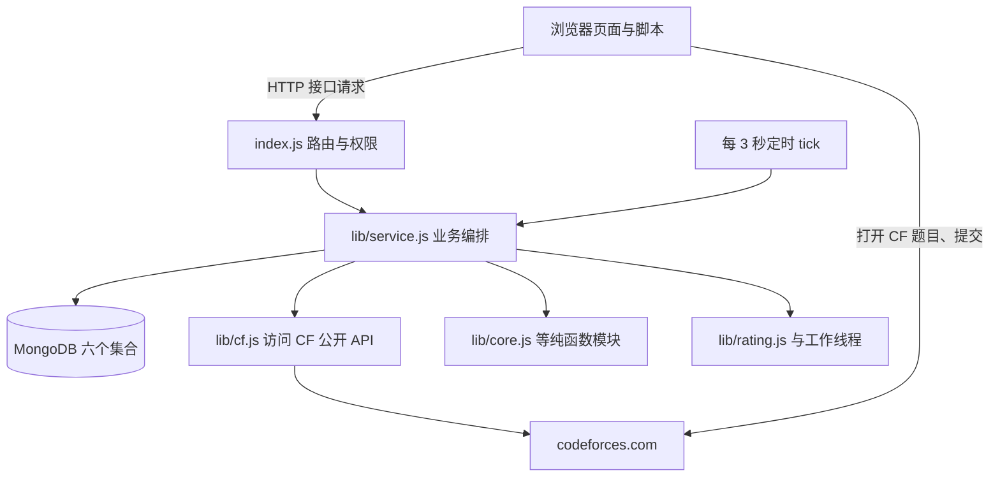

# 代码阅读指南

这份指南写给**第一次接触完整项目**的同学：学过变量、循环、函数，但没有做过项目，也不熟悉 JavaScript、网页、数据库。它不替代[接手指南](../project-guide.md)和[新手入门](../新手入门.md)，而是把每个源码文件逐一讲清楚：它为什么存在、在什么时候运行、数据从哪里来又到哪里去、源码从哪里开始读。

## 先理解这个项目在做什么

场景：老师想用一场**已经结束的 Codeforces（简称 CF）比赛**组织一次统一训练。学生还是在自己的 CF 账号上读题、提交代码、等评测；Hydro（一个在线评测系统，相当于"网站平台"）提供登录、域名（每个域是一块互相隔离的数据空间，英文叫 domain）、权限和网页；本插件（addon，指被 Hydro 加载的一份扩展代码）负责中间的一切：

- 记录每个学生绑定了哪个 CF 账号；
- 定时抓取学生的公开提交历史（只读 CF 公开数据）；
- 帮教练筛掉学生已经做过的题，允许换题；
- 比赛结束后把学生在统一时间窗口内的提交算成分数，产生一个**本地训练 Rating**（模拟评分，不是 CF 官方评分）。

一句话：**Hydro 管"网站"，插件管"训练业务"。** 学生仍然在 CF 提交代码，插件不会代替提交，也不会修改 CF 官方数据或 Hydro 自带积分。

## 技术名词速查

第一次出现的技术词都在这里解释；各文件说明里不再重复。

| 名词 | 用日常语言解释 |
| --- | --- |
| Node.js | 让 JavaScript 能像 C++ 程序一样在命令行运行的环境。本项目要求 Node ≥ 22。 |
| CommonJS / `require` | JavaScript 的模块写法：一个文件用 `module.exports` 导出，另一个文件用 `require('./xxx')` 引入。类似于把函数声明放进 `.h`、实现放进 `.cpp` 再引用。 |
| Hydro / addon | 宿主网站平台；插件是它加载的一个 addon。插件不能独立运行，必须由 Hydro 进程加载。 |
| MongoDB / 集合（collection） | 数据库，数据以"文档"（类似 JSON 的对象）形式放进"集合"（类似表）。本插件用六个集合，名字见 [lib/service.js.md](lib/service.js.md)。 |
| 服务器 / 浏览器 | 服务器 = Hydro 进程，运行插件后端代码；浏览器 = 学生的电脑上的网页，运行模板里的脚本。两者通过 HTTP 接口通信。 |
| 接口（API）/ 路由 | 浏览器向服务器发一个带参数的请求，服务器执行对应函数再返回 JSON。`/cf-training/api?action=...` 就是接口地址。 |
| 模板 / Nunjucks | 服务器渲染网页用的模板语言：`{{ 变量 }}` 替换成值，`` 控制显示。渲染完成后浏览器收到的是普通 HTML。 |
| 前端 / 后端 | 前端 = 浏览器里跑的代码（网页模板中的 `<script>`）；后端 = 服务器上跑的代码（`index.js`、`lib/`）。 |
| worker（工作线程） | 同一个进程里的"分身"，并排跑耗时计算，避免卡住网页请求。本项目用它算 Rating。 |
| CSRF token | 一串随机字符，证明"这个写操作来自本人页面"，防止其他网站冒用登录状态发请求。 |
| 同步 / 后台任务 / 队列 | 抓 CF 数据要分页、要限速，不能在网页请求里现场等，于是写进数据库排队，由定时器慢慢执行。 |
| Rating | 评分。本项目指根据训练名次计算的本地分数，是**模拟估计**，与 CF 官方 Rating、题目难度 Rating 都不同。 |
| CAS / revision | 一种并发控制：读档案时记住版本号，写回时要求版本没变，否则重试。防止两个人同时改同一份数据互相覆盖。 |

## 一次训练的数据流

完整业务顺序：学生绑定 handle → 后台同步公开提交 → 教练确认账号与班级 → 导入原赛参照榜 → 创建草稿并换题 → 发布 → 学生签到、在 CF 提交 → 赛后重新同步 → 预览并确认结算 → 需要纠错时撤销重算。每一步对应哪个文件，见下面的阅读路线。

## 目录地图

| 位置 | 说明 |
| --- | --- |
| 根目录 | [根目录导航](#根目录文件) |
| `lib/` | 业务模块，全部运行在 Hydro 服务器进程（或它派生的 worker）里：[lib/README.md](lib/README.md) |
| `templates/` | 网页模板与浏览器脚本：[templates/README.md](templates/README.md) |
| `locales/` | 导航栏、权限名的翻译：[locales/README.md](locales/README.md) |
| `scripts/` | 打包、部署、备份工具，用命令行运行：[scripts/README.md](scripts/README.md) |
| `test/` | 自动化测试：[test/README.md](test/README.md) |
| `test/e2e/` | 浏览器/真实服务验收脚本：[test/e2e/README.md](test/e2e/README.md) |

### 根目录文件

| 文件 | 说明 |
| --- | --- |
| [`index.js`](../../index.js) | 插件入口：Hydro 加载时注册权限、路由、定时器；所有接口的权限与参数入口。见 [index.js.md](index.js.md)。 |
| [`package.json`](../../package.json) | 插件身份卡：名字、版本、入口文件、Node 版本要求。见 [package.json.md](package.json.md)。 |
| [`.gitignore`](../../.gitignore) | 让 Git 忽略依赖、临时产物与本地凭据的清单。见 [.gitignore.md](.gitignore.md)。 |
| [`README.md`](../../README.md) | 面向使用者与维护者的总说明（本指南的入口加在它的开头附近）。 |
| [`CHANGELOG.md`](../../CHANGELOG.md) | 版本变更记录。 |
| `docs/` | 已有文档目录（接手指南、部署恢复、E2E 说明、试训记录等），本指南不重复介绍，见 [docs/](../../docs/)。 |

**不在本指南范围内**（第三方依赖、构建产物、缓存、日志、临时文件和凭据）：`dist/`、`dist-final/`、`dist-rc1-final/`（本地打好的候选包）、`.test-output/`（测试截图、临时凭据）、`.workbuddy/`（工具状态）、`node_modules/`、`.deployment.json`（部署时生成，含探测密钥）。`docs/` 与 `test/e2e/README.md` 是已有文档，本指南只链接、不重复介绍。

## 三条阅读路线

1. **只想知道网页上点一下会发生什么**：先读 [templates/cf_training_app.html.md](templates/cf_training_app.html.md) 的 `api()` 和 `refresh()`，再去 [index.js.md](index.js.md) 找同名 `action`，最后进入 [lib/service.js.md](lib/service.js.md)。这就是"按钮 → 接口 → 业务"的完整链条。
2. **想改业务规则（计分、资格、评分）**：读 [lib/core.js.md](lib/core.js.md)（纯规则）→ [lib/exposure.js.md](lib/exposure.js.md)（接触证据）→ [lib/rating.js.md](lib/rating.js.md)（评分重放）→ [lib/service.js.md](lib/service.js.md)（`result/preview/settle` 如何组合它们）。修改前先看 [test/README.md](test/README.md) 里对应测试。
3. **想先把项目跑起来**：看 [test/README.md](test/README.md) 的"本地测试"一节，在插件目录执行 `node --test test/*.test.js`。不需要 Hydro 也能跑大部分测试。

## 本次说明的验证状态

本指南根据工作树源码整理（AI 补充，2026-09-27，本机时区）。本次只做了不依赖外部服务的验证：

- 在插件目录运行 `node --test test/*.test.js`（Node v22.18.0）：共 88 项，68 通过、0 失败、20 跳过；跳过项需要真实 MongoDB 或真实 CF 网络（环境变量见 [test/README.md](test/README.md)）。
- 运行 `node scripts/package.cjs --list`：清单 62 个文件，未包含 `docs/code-guide/`（新文档不会进入部署包）。
- 运行 `node test/bench-rating.cjs`：退出码 0，`originalReplayEqual: true`；本机冷读约 5.6 ms、后台重建约 53.7 秒、热读约 0.6 ms（单次记录，详见 [test/bench-rating.cjs.md](test/bench-rating.cjs.md)）。

**没有执行**的操作：部署或重启 Hydro、连接真实 MongoDB、调用真实 CF 账号、运行浏览器回归与真实服务验收。涉及这些内容的描述来自源码阅读与仓库既有文档，不代表本次重新验证通过。README 中引用的历史测试数量与截图属于仓库记录。

## 容易混淆的三件事

- 插件不是独立网站：没有 `npm start`，不能 `node index.js` 直接启动，必须由 Hydro 加载。
- 测试分很多档：本地模拟（不需要外部环境）、真实 MongoDB 临时库、真实 CF API、浏览器模板回归、独立 Hydro 容器验收。看到"测试通过"要先问是哪一档，见 [test/README.md](test/README.md)。
- Rating 是模拟值：算法参考 CF 2015 公开方法，但题面换题、参照名单不完整都会降低可比性；不要当成官方成绩。
