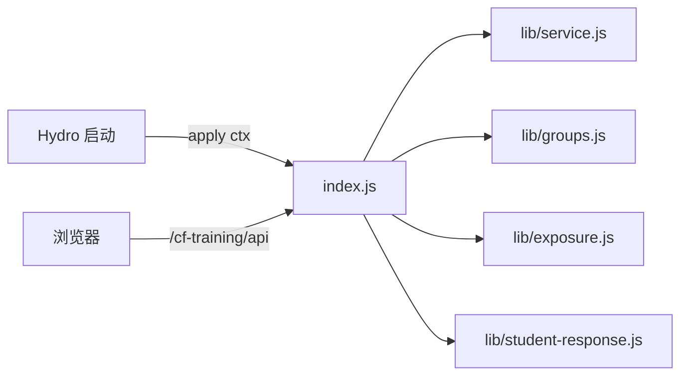

# `index.js`：插件入口与 HTTP 边界

对应源码：[index.js](../../index.js)

## 1. 它解决什么问题

Hydro 启动时，会把每个 addon 的入口文件加载一遍，并调用其中的 `apply(ctx)` 函数，相当于插件"开机自检"。这个文件就是插件的开机程序：

- 注册一个只有教练才有的权限（BigInt 第 100 位，见 [lib/permissions.js.md](lib/permissions.js.md)）；
- 启动业务服务 `TrainingService`（[lib/service.js.md](lib/service.js.md)）；
- 注册 4 个网页路由和 1 个健康检查路由；
- 挂一个每 3 秒执行一次的定时器，让后台同步任务持续前进；
- 每个接口请求进来时，检查登录、域、权限和 CSRF token，再把 `action` 分派到具体业务函数或直接调用 `service`。

**没有这个文件，Hydro 根本不知道插件存在。** 反过来，它自己也不能独立运行：第一行就 `require('hydrooj')`，直接 `node index.js` 会报模块找不到。

## 2. 它在项目中的位置

运行位置：Hydro 的**服务器进程**（不是浏览器，也不是命令行工具）。

- 被谁调用：Hydro 的 addon 加载器调用 `apply(ctx)`；浏览器网页通过 HTTP 请求访问它注册的路由。
- 它调用谁：`lib/service.js`（业务）、`lib/core.js`（参数校验与 `digest`）、`lib/groups.js`（班级权限）、`lib/rating.js`（`ratingKey` 版本比对）、`lib/exposure.js`（自报接触留存）、`lib/student-response.js`（学生可见字段白名单）、`lib/permissions.js`。
- 它注册的接口最终再把结果交给模板：[templates/cf_training.html.md](templates/cf_training.html.md) 和 [templates/cf_training_app.html.md](templates/cf_training_app.html.md)。

## 3. 数据怎样经过它

### GET 请求（读数据）

接口 `/cf-training/api` 用查询参数 `action` 区分操作，通常返回 `{ ok: true, result: 项目 }`；出错返回 `{ ok: false, error: '原因' }`。

常用读取 action：

| action | 作用 | 权限 |
| --- | --- | --- |
| `dashboard` | 页面主数据：账号、训练列表、班级、榜单、后台任务 | 登录即可，内容按身份裁剪 |
| `run` | 一场训练的详情与榜单 | 登录；学生只能看自己参与的非草稿 |
| `problems` / `problem_stats` | 本人题目记录与统计 | 登录，固定用当前登录用户 |
| `group_leaderboard` | 班级榜 | 班级成员或管理者 |
| `discover` / `replacements` | 选赛筛查、换题候选 | 教练权限 + 可管理该班级 |
| `preview` / `export` | 结算预览、导出档案 | 教练权限 |

### POST 请求（写数据）

POST 请求体是 JSON，必须带 `x-cf-training-csrf` 请求头，值等于页面由 Hydro 会话生成的 token（登录后第一次打开页面时写入 `session.cfTrainingCsrf`，见 `TrainingPage.get`）。

| action | 作用 |
| --- | --- |
| `bind` / `rebind` | 学生绑定 CF handle；教练换绑 |
| `sync` | 请求同步学生历史（进队列） |
| `seen` / `unsee` | 学生补充/删除"我见过这道题/这场比赛" |
| `attend` | 签到 |
| `group`、`group_rename`、`group_members`、`group_admin`、`group_claim`、`group_transfer*`、`delete_group` | 班级增删改与转让 |
| `correct_exposure` | 教练纠正误报接触证据 |
| `approve` | 教练确认账号归属 |
| `catalog` / `import` | 同步题库、导入历史参照榜 |
| `create` / `replace` / `reschedule_draft` / `cancel_draft` / `practice` / `publish` | 组赛与草稿生命周期 |
| `refresh_run` | 重新同步一场比赛的全部学生 |
| `settle` / `void` | 确认结算、撤销结算 |

副作用：GET 全部只读；POST 会改 MongoDB（档案、任务队列），`catalog`/`import`/`sync` 还会在后台访问 CF 网络。`index.js` 本身不直接读写数据库，都通过 `service`。

## 4. 源码怎么读

按出现顺序读：

1. `exports.apply`（第 12 行起）：整个插件的启动流程。注意 `service.init()`、`.deployment.json` 读取、路由注册和最后的 `setInterval` 与 `ctx.on('dispose')`。
2. `TrainingHealth`（第 20 行）：部署健康检查。用 `timingSafeEqual` 比较 `x-cf-training-probe` 头和安装时生成的密钥；没有密钥的请求一律 403。它只查一次集合、不返回任何用户数据，输出模板 [cf_training_health.html.md](templates/cf_training_health.html.md)。
3. `TrainingPage` 家族（第 53 行）：三个页面共用。`TrainingEntry` 是通用入口 `/cf-training`，按权限跳转；`TrainingCoachPage` 要求教练权限；学生访问教练页会被拒绝，教练访问学生页会被重定向。
4. `TrainingApi.prepare`（第 74 行）：所有接口的公共检查——必须登录、URL 中的 domain 必须与当前域一致。
5. `TrainingApi.get` / `TrainingApi.post`：两个大 `if` 分发。想找某个按钮做了什么，先在前端模板里搜 `api('动作名'`，再到这里搜同一个名字。
6. `ctx.Route` 与 `ctx.injectUI`（第 313–317 行）：路由名（`cf_training` 等）与语言文件 [locales/zh.yaml.md](locales/zh.yaml.md) 里的键一一对应。
7. 第 318 行起：`setInterval` 每 3 秒调用 `service.tick()`；`timer.unref()` 让定时器不阻止进程退出；`ctx.on('dispose')` 在插件卸载时清定时器、关评分 worker。

几个容易忽略的设计：

- **身份永远取登录用户**：`const uid = this.user._id`。请求里传的 `uid` 参数只在教练操作他人时使用，且会再次检查权限，不改变"我是谁"。
- **权限分三层**：登录用户（`PRIV.PRIV_USER_PROFILE`）、教练（`PERM_CF_TRAINING_COACH`）、域管理员（`PERM.PERM_EDIT_DOMAIN`）。班级所有者/管理员是单班授权，不等于教练，见 [lib/groups.js.md](lib/groups.js.md)。
- **学生的详情响应必须过投影**：`studentRunResponse()` 会把内部字段（接触证据、同步诊断、快照等）过滤掉。新增字段时不要绕开它。
- **`c.fail()` 抛的是普通 Error**，在这里被 catch 成 `{ ok: false, error }`；权限类错误（`ForbiddenError`、`GroupAccessDenied`）继续抛给 Hydro，变成 403。
- **`create` action 里的发布筛查**：教练点"发布"时，先 `screening()` 重新查一遍接触证据，再在 CAS 里核对该档案没被别人改过，最后写 `configHash`。这是"发布后题目锁定、资格按发布时刻留存"的实现点。

## 5. 怎样使用或验证

- 不能运行：`node index.js` 会因缺少 Hydro 模块失败。它只在 Hydro 进程里工作。
- 本地验证：`node --test test/permissions.test.js`。这个测试把 `index.js` 放进 VM 沙箱，用假的 `hydrooj` 模块真实执行 `apply`，然后直接调用路由类检查权限、CSRF、字段白名单。这是"不启动 Hydro 也能测接口逻辑"的关键手段，细节见 [test/permissions.test.js.md](test/permissions.test.js.md)。
- 真实验证：独立 Hydro 容器中的 `test/e2e/release.cjs` 会通过真实 HTTP 访问这些路由，见 [test/e2e/release.cjs.md](test/e2e/release.cjs.md)。

## 6. 容易误解的地方

- **`index.js` 不是"业务逻辑"**：它只做鉴权、参数校验和转发；计分、资格、评分都在 `lib/`。修改业务优先改 `lib`，改接口形状才动这里。
- **改 action 名称要同时改三处**：`index.js` 的分发、前端模板的 `api()` 调用、以及 [test/permissions.test.js.md](test/permissions.test.js.md)（它按 action 名断言）。
- **`jobs` 列表的学生可见性**：学生只能看到自己的 `sync` 任务，这是 `get` 里 `jobs` 过滤的条件；不要为了"方便"放开。
- **健康检查不是业务接口**：`/cf-training/health` 需要安装密钥且只返回构建标记，部署脚本用它确认"新代码真的在跑"。
- **定时器是"驱动力"，不是"实时"**：每 3 秒只是调度频率，实际同步受队列和 CF 限速影响，页面上要等"刷新状态"后才会看到进展。

返回上一级：[根目录导航](README.md)。
