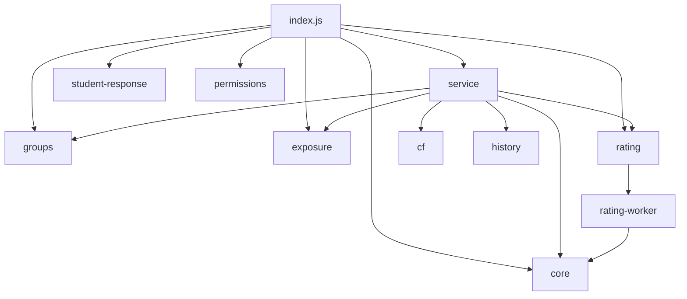

# `lib/`：业务模块目录

`lib/` 放插件的全部业务代码：绑定、同步、组赛、资格判断、计分、评分、班级、数据读写。它们全部运行在 **Hydro 服务器进程**里（只有 [rating-worker.js](rating-worker.js.md) 运行在进程内派生的工作线程中），由 [index.js](../index.js.md) 和彼此互相调用。浏览器不认识这些文件。

## 模块一览

| 文件 | 一句话职责 | 运行位置 | 主要测试 |
| --- | --- | --- | --- |
| [`cf.js`](../../../lib/cf.js) | 访问 CF 公开 API：方法白名单、串行限速、超时重试 | 服务器进程 | [core.test.js](../test/core.test.js.md) 末尾 |
| [`core.js`](../../../lib/core.js) | 纯函数工具箱：校验、解析、计分、排名、接触判定、rating 算法 | 服务器进程（也被 worker 使用） | [core.test.js](../test/core.test.js.md) 等 |
| [`exposure.js`](../../../lib/exposure.js) | 把"谁接触过哪题"的事实留存进训练、兼容旧快照、处理纠正 | 服务器进程 | [exposure-evidence.test.js](../test/exposure-evidence.test.js.md) |
| [`groups.js`](../../../lib/groups.js) | 班级所有权、管理员、转让、名单变更与可见性 | 服务器进程 | [groups.test.js](../test/groups.test.js.md) |
| [`history.js`](../../../lib/history.js) | 把提交记录聚合成"题目列表"与统计基础 | 服务器进程 | [history.test.js](../test/history.test.js.md) |
| [`permissions.js`](../../../lib/permissions.js) | 注册教练权限位并在卸载时清理 | 服务器进程 | [permissions.test.js](../test/permissions.test.js.md) |
| [`rating.js`](../../../lib/rating.js) | 评分输入版本键、进程内缓存、worker 生命周期、重放逻辑 | 服务器进程 | [rating-computation.test.js](../test/rating-computation.test.js.md) |
| [`rating-worker.js`](../../../lib/rating-worker.js) | 在子线程里执行耗时评分，避免卡住网页请求 | 工作线程 | [rating-peak.test.js](../test/rating-peak.test.js.md) |
| [`service.js`](../../../lib/service.js) | 业务总编排与 MongoDB 读写（六个集合） | 服务器进程 | [integration.test.js](../test/integration.test.js.md) 等 |
| [`student-response.js`](../../../lib/student-response.js) | 学生训练详情的字段白名单（防泄露） | 服务器进程 | [permissions.test.js](../test/permissions.test.js.md) |

## 依赖关系

箭头含义是"前者引入后者"。注意两点：

- `core.js` 不引用任何其他项目模块，也不碰数据库和网络，是纯粹的计算与校验，因此最容易被单独测试（见 [core.js.md](core.js.md)）。
- `service.js` 是唯一直接写 MongoDB 的模块；其他模块拿到的是 `service` 传进来的普通对象。

## 适合新手的阅读顺序

1. [core.js.md](core.js.md)：先认识计分和接触判断这两件"业务上的事"是怎么算的。
2. [history.js.md](history.js.md) → [cf.js.md](cf.js.md)：数据从 CF 抓来长什么样、怎么被整理。
3. [service.js.md](service.js.md)：把上面零件串成完整流程（绑定 → 同步 → 组赛 → 结算）。
4. [exposure.js.md](exposure.js.md) → [rating.js.md](rating.js.md) / [rating-worker.js.md](rating-worker.js.md)：资格证据与评分重放。
5. [groups.js.md](groups.js.md) → [permissions.js.md](permissions.js.md) → [student-response.js.md](student-response.js.md)：权限与数据暴露边界。

## 用一条流程串起来：学生从绑定到出现在榜单上

1. 学生在页面填 handle，[index.js](../index.js.md) 校验权限后调用 `service.bind`（[service.js.md](service.js.md)）。`bind` 在域档案里创建账号记录、生成 `bindingId`，再通过 `queueSync` 把同步任务写进 `cftrain_job` 集合。
2. 每 3 秒的定时器触发 `service.tick`，它抢到多进程共享锁后取一个任务，用 [cf.js](cf.js.md) 调 `user.info`、`user.status` 分页抓提交，把每页写进 `cftrain_submission`，并调用 [exposure.js](exposure.js.md) 的 `capture` 留存已发布训练的赛前证据。
3. 教练用 [groups.js](groups.js.md) 维护班级，导入比赛时 `service.importContest` 把参照榜冻结到 `cftrain_reference`，创建草稿时保存成员快照。
4. 赛后 `service.result` 用 [core.js](core.js.md) 的 `scoreRun` 算分、用 [exposure.js](exposure.js.md) 的 `history` 判断资格，再检查扫描证明是否覆盖整场比赛。
5. `service.preview` / `settle` 把有效成绩写进结算记录，[rating.js](rating.js.md) 在后台按时间顺序重放全部结算，算出每个学生的本地 Rating；[templates/](../templates/README.md) 把它画成榜单和曲线。

## 容易误解的地方

- 这里没有独立的 Web 服务：不要试图 `node lib/service.js` 启动任何东西；`service.js` 需要 Hydro 传入数据库连接。
- `lib/` 下的函数**不代表**都可以随意调用：改动 `change` 回调、同步代次、扫描证明、权限判断等，都有对应测试约束，先读 [test/README.md](../test/README.md) 的对照表。
- 三个同名易混概念：`bindingId`（某个学生一次绑定的内部编号）、`uid`（Hydro 用户编号）、`handle`（CF 账号名），见 [接手指南](../../../docs/project-guide.md) 的概念表。

返回上一级：[根目录导航](../README.md)。
