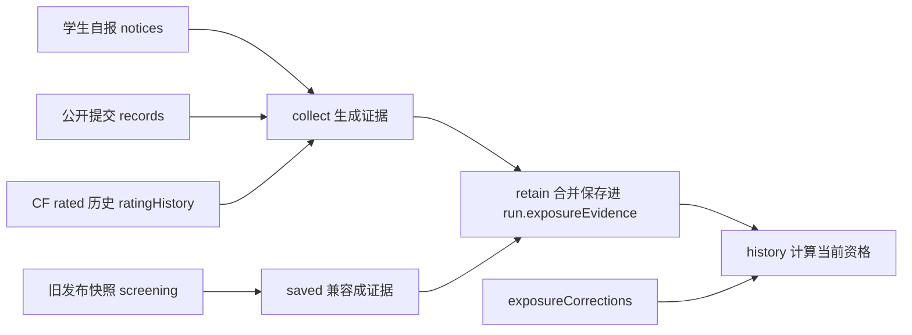

# `lib/exposure.js`：把"接触过题目"变成可核对的证据

对应源码：[lib/exposure.js](../../../lib/exposure.js)

## 1. 它解决什么问题

计分训练的前提是"学生赛前没有做过这些题"。但判断依据会随时间变化：学生可能补做、删除自报、CF 重新判题，甚至换绑账号。如果只按"现在查一次"决定资格，删除自报就能洗掉记录。

这个文件把**已经确认过的事实**变成带编号的证据保存进训练档案：

- 每条证据有固定 `id`，例如 `submission:77:problem`（第 77 条提交碰到了某题）、`submission:88:contest`（第 88 条提交证明参加过原赛）、`notice:100/A`（学生自报）、`rating:1919`（CF rated 参赛历史）、`publication:...`（旧版本发布快照里已有的聚合事实）。
- 删除再添加同一条自报，`id` 不变，因此"已确认的事实"和"教练的误报纠正"都不会被洗掉。
- 教练纠正误报时，只能按证据 `id` 一条条覆盖，不能一键清空资格。

## 2. 它在项目中的位置

- 被谁调用：[lib/service.js](service.js.md)（同步写入 `capture`、详情组装 `history`、发布筛查 `screening`、纠正 `correctExposure`）和 [index.js](../index.js.md)（学生自报增删后触发 `capture`）。
- 它调用谁：[lib/core.js](core.js.md) 的 `problemKey` 与 `exposure`。
- 运行位置：服务器进程。所有函数接收 state 对象并**原地修改**（在 `service.change` 的 CAS 回调里调用），由 `service` 负责整体写库。

## 3. 数据怎样经过它

| 函数 | 作用 |
| --- | --- |
| `collect(account, records, notices, contestId, problems, at)` | 从三类来源生成证据数组；只取 `at`（通常是开赛时间）之前的记录；每条证据含 `source`（manual/submission/participation/rating）、`key`、`occurredAt` |
| `saved(run, uid)` | 读取训练里已保存的证据；兼容旧快照：旧版 `screening` 只有聚合字段（`attended`/`touched`/`accepted`），把它们转换成 `publication` 来源的证据，但**不会**把 `unknown` 转成正证据 |
| `retain(run, uid, evidence)` | 把新证据按 `id` 合并进 `run.exposureEvidence[uid]`（同一 `id` 只留一条） |
| `capture(state, uid, records, notices)` | 遍历该学生所有已发布训练，把赛前证据留存进去；同步分页和自报变动后都会调用 |
| `history(run, uid, account, records, notices)` | 组装训练详情里的资格判断：合并已保存证据 + 当前能查到的事实，扣除被纠正的 `id`，输出 `attended`、`touched`、`evidence`、`corrections`、`publicationMissing` 和 `status` |

关键边界（注释里写明，也被测试锁定）：

- 证据 `id` 描述"事实"而不是"某次插入操作"：删除再添加自报，事实与纠正都保留。
- 没有发布快照的旧训练不会凭空造证据，只标记 `publicationMissing`。
- 开赛之后新产生的接触事实**不会**回溯成为赛前证据——`collect` 以开赛时间 `at` 过滤。

## 4. 源码怎么读

全文 65 行，顺序就是数据流：

1. `collect`：先看自报，再看提交（分"碰到题"和"参加原赛"两类），最后看 rated 历史。
2. `saved`：理解 `check?.evidence || [...]` 这段旧数据兼容分支。
3. `merge`：按 `id` 去重、按 `id` 排序，保证顺序稳定。
4. `retain` / `capture`：注意 `capture` 只处理 `status === 'published'` 且 `bindingId` 一致的训练——换绑后旧账号的证据不会算到新账号头上。
5. `history`：最后的 `status` 优先级：`unknown` > `attended` > 有 `touched` > `clear`。

## 5. 怎样使用或验证

- 不能单独运行；它需要 `service` 提供 state。
- 本地测试：`node --test test/exposure-evidence.test.js`，覆盖"删除自报后证据仍保留""旧快照兼容""纠正只覆盖所选证据""纠正后仍受其他条件约束""撤销结算后纠正与重新结算"。真实 Mongo 用例验证重启后证据与纠正仍在。
- 接口测试：`node --test test/permissions.test.js` 里的 `seen/unsee`、`correct_exposure` 用例。
- 浏览器回归：`node test/e2e/exposure.cjs` 用真实模板检查纠正表单（必填理由、已纠正项禁用、文案转义）。

## 6. 容易误解的地方

- **它不是"资格判断"的唯一入口**：训练详情里是否算分由 `service.result` 组合 `history`、签到、`practice` 标记和扫描证明共同决定，见 [lib/service.js.md](service.js.md)。
- **旧快照里的 `unknown` 不会变成证据，也不会变成清白**：它只是"信息不足"；后来同步出的赛前证据可以增加接触事实。
- **纠正不是删除证据**：纠正记录 `exposureCorrections` 与证据并存，页面会显示"已纠正"；新发现的其他证据仍会阻止计分。
- **改这里要同步看**：[test/exposure-evidence.test.js.md](../test/exposure-evidence.test.js.md)、[test/permissions.test.js.md](../test/permissions.test.js.md)、[test/e2e/exposure.cjs.md](../test/e2e/exposure.cjs.md)，以及 [lib/service.js.md](service.js.md) 中所有 `capture`/`retain` 的调用点。

返回上一级：[`lib/` 目录导航](README.md)。
