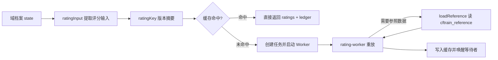

# `lib/rating.js`：评分版本、缓存与工作线程调度

对应源码：[lib/rating.js](../../../lib/rating.js)

## 1. 它解决什么问题

每次打开主页、班级榜、结算预览或导出档案，都要把该域**全部历史结算**按时间顺序重放一遍，才能得到每个学生的当前 Rating。这个计算量随"场次 × 人数 × 参照池大小"增长，如果直接在网页请求里算，页面会卡住。

这个文件做三件事：

1. `ratingInput(state)` / `ratingKey(state)`：从域档案里提取**真正影响评分的输入**（固定起点、按结束时间排序的有效结算事件、算法版本），算出一个内容摘要作为版本键。同步状态、班级改名等不影响评分的变化不会改变版本键。
2. `replayOriginal(input, reference)`：串行的原始重放实现：逐场调用评分引擎，把上一场的结果作为下一场的起点。它既是工作线程的实际算法，也是性能对照脚本里的"标准答案"。
3. `RatingCache`：进程内缓存与任务调度。读请求要么命中缓存立即返回，要么得到一个 `computing` 状态并在后台用工作线程计算；相同版本的并发请求合并成同一个任务。

## 2. 它在项目中的位置

- 被谁调用：[lib/service.js](service.js.md)（`replay`、`preview`、`settle` 等）与 [index.js](../index.js.md)（`ratingKey` 用来核对"读取期间 Rating 有没有变化"）。
- 它调用谁：`node:worker_threads`、[lib/core.js](core.js.md)（摘要、算法版本）、以及由调用方传入的 `loadReference`（从 `cftrain_reference` 读参照快照）。
- 运行位置：主体在服务器进程；实际重放在 [rating-worker.js](rating-worker.js.md) 子线程里执行。

## 3. 数据怎样经过它

### `RatingCache` 的参数与行为

| 参数 | 默认值 | 含义 |
| --- | --- | --- |
| `maxTasks` | 8 | 运行 + 排队任务上限；满了以后 `wait: false` 返回 `busy`，等待式读取报"队列已满" |
| `maxEntries` | 16 | 缓存条目上限（LRU：命中会移到末尾，超限从最旧淘汰） |
| `maxBytes` | 32 MiB | 缓存总字节上限，单条超限直接报"超出缓存容量" |
| `timeoutMs` | 30 分钟 | 单任务超时 |
| 工作线程堆 | 256 MiB | 由 `new Worker` 的 `resourceLimits` 限制 |

读取结果的状态：

- `ready`：带 `version` 与完整 `ratings`/`ledger`；
- `computing`：后台正在算（`wait: false` 时立即返回）；
- `busy`：任务队列已满；
- `failed`：计算失败，缓存里记 `error` 和 `retryAt`（1 秒内重试会被拒绝，之后自动清除重试）。

失败与退出处理：worker 提前退出、超时、抛出错误都会让等待者收到错误，同时缓存里留下"失败状态"，页面显示原因而不是旧结果。

## 4. 源码怎么读

1. 第 7–16 行：`ratingInput` 与 `ratingKey`。注意"过滤 `void`、按 `endAt` 排序、只保留 input 的计分字段"这三步——它们决定哪些改动会触发重算。
2. 第 18–32 行：`replayOriginal`。它按事件顺序逐个 `engine(row, 当前rating)`，起点缺失时用 1400。这个实现被 [test/rating-computation.test.js](../test/rating-computation.test.js.md) 当作独立参照物。
3. 第 34–121 行：`RatingCache`。按 `read → pump → finish` 读一遍，就能看懂"缓存命中、任务合并、worker 启动、消息往返、超时/失败、关闭"的完整生命周期。
4. 关键细节：`read` 会把调用方传入的 state **先转成 detached 的 input** 再返回 `computing`，这样调用方后续修改 state 不会污染正在排队的任务。

## 5. 怎样使用或验证

- 不能单独运行。
- 本地测试：`node --test test/rating-computation.test.js`（重放等于原始实现、缓存命中、同版本合并、旧任务不能覆盖新版本、worker 退出与重试、缓存边界、两实例/重启重建、预览 token 与版本校验）。
- 峰值口径：`node --test test/rating-peak.test.js` 用真实 worker 验证撤销早期结算后后续成绩重算。
- 性能对照：`node test/bench-rating.cjs`（构造数据，不连外部服务；输出冷读、重建、热读耗时与事件循环最大停顿）。
- 真实验证：独立 Hydro 容器验收会实际重启进程观察缓存重建，见 [test/e2e/release.cjs.md](../test/e2e/release.cjs.md)。

## 6. 容易误解的地方

- **缓存版本不是档案 revision**：普通同步、班级改名、扫描证明变化都不会让评分重算（避免无意义计算）；而结算、撤销、起点变化会。预览 token 则会因这些"不影响评分"的变化而失效——因为 token 还绑定了扫描依据与资格（见 [lib/service.js.md](service.js.md) 的 `preview`）。
- **没有跨进程失效通知**：每个 Hydro 进程各有一份缓存，冷启动各自重建一次，但都从数据库的权威输入出发，所以结果一致。
- **`wait: false` 不等于计算完不阻塞**：它返回后工作线程仍在跑；页面此时显示"计算中"，要再刷新。
- **缓存里返回的对象是副本**：调用方修改返回值不会污染缓存（`replay` 做了浅拷贝）。
- 修改算法必须新增版本号并保留旧实现，见 [lib/core.js.md](core.js.md) 的说明。

返回上一级：[`lib/` 目录导航](README.md)。
