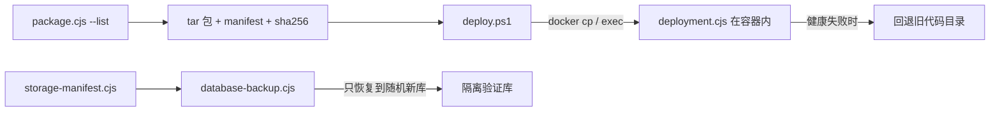

# `scripts/`：打包、部署与备份工具

这个目录里的文件都是**命令行工具**，不参与 Hydro 运行时的页面和接口。它们回答"怎么把代码安全地交到目标服务器上，怎么在出问题时把数据和代码恢复回来"。

| 文件 | 说明 | 什么时候运行 |
| --- | --- | --- |
| [`package.cjs`](../../../scripts/package.cjs) | 生成候选包清单、`.tar` 与逐文件哈希。见 [package.cjs.md](package.cjs.md)。 | 发版/交付前，本地 Windows 或 Linux |
| [`deploy.ps1`](../../../scripts/deploy.ps1) | Windows 上的部署入口：把包送进 WSL/Docker 并调用部署逻辑。见 [deploy.ps1.md](deploy.ps1.md)。 | 运维人员在 Windows + WSL 环境 |
| [`deployment.cjs`](../../../scripts/deployment.cjs) | 真正执行"静态检查 → 备份 → 停机 → 换目录 → 启动 → 健康探测 → 失败回退"的事务。见 [deployment.cjs.md](deployment.cjs.md)。 | 由 `deploy.ps1` 或测试调用；也可在容器内直接运行 |
| [`database-backup.cjs`](../../../scripts/database-backup.cjs) | 离线备份六个集合，并把备份恢复到独立随机库做核对。见 [database-backup.cjs.md](database-backup.cjs.md)。 | 维护窗口，需停止全部写入者 |
| [`storage-manifest.cjs`](../../../scripts/storage-manifest.cjs) | 查询六个逻辑集合在数据库中的真实物理名。见 [storage-manifest.cjs.md](storage-manifest.cjs.md)。 | 备份前、排障时，在 Hydro CLI 环境执行 |
| [`recovery-contract.json`](../../../scripts/recovery-contract.json) | 数据恢复契约：epoch 与集合名单。见 [recovery-contract.json.md](recovery-contract.json.md)。 | 被上述脚本读取 |

## 这几个脚本的关系

## 一条流程串起来：一次发版

1. 本地运行 `node scripts/package.cjs /tmp/cf-training-candidate` 生成候选包（含清单与哈希）。
2. 把包解到一个全新目录，确认哈希与清单一致。
3. 在获准环境运行 `.\scripts\deploy.ps1 -Distribution Ubuntu -Container <容器名>`；脚本内部先 `package.cjs --list` 重新收集文件，再交给容器里的 `deployment.cjs`。
4. `deployment.cjs` 静态检查全部 JS/模板、备份旧目录、停机切换、启动并用 `/cf-training/health` 验证构建标记。
5. 失败自动回退旧代码并重新健康检查；回退失败时 Hydro 保持停止并给出备份编号。
6. 需要数据恢复时，先按 [数据库备份说明](database-backup.cjs.md) 离线备份，再恢复到独立随机库核对，不自动覆盖原库。

## 风险与边界（务必先读）

- 这些脚本会**停服务、换目录、启动服务**，只允许在获准的测试/维护环境操作。操作细节以仓库的[部署与恢复](../../../docs/deployment-recovery.md)文档为准。
- `database-backup.cjs` 的 `restore-isolated` 只写随机新库；`backup` 要求显式 `--writers-stopped`，防止备份到一半的数据。
- `deploy.ps1` 会清理自己创建的临时目录 `/tmp/cf-training-deploy-<随机>`；不会删除恢复备份。
- 本目录的脚本不读学生笔记、不接触业务数据本身，除非你显式给出 Mongo 地址。

## 新手阅读顺序

先读 [package.cjs.md](package.cjs.md)（30 秒）→ [recovery-contract.json.md](recovery-contract.json.md)（30 秒）→ [storage-manifest.cjs.md](storage-manifest.cjs.md) → [database-backup.cjs.md](database-backup.cjs.md) → [deployment.cjs.md](deployment.cjs.md)（最长，只有想理解部署机制时细读）→ [deploy.ps1.md](deploy.ps1.md)。

返回上一级：[根目录导航](../README.md)。
