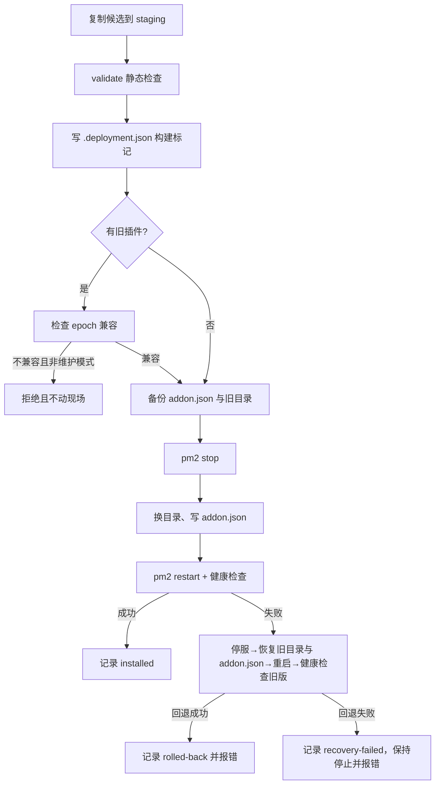

# `scripts/deployment.cjs`：容器内的部署事务

对应源码：[scripts/deployment.cjs](../../../scripts/deployment.cjs)

## 1. 它解决什么问题

换代码最怕"切到一半失败，网站起不来"。这个脚本把部署做成一个小型事务：先检查新代码、备份旧代码，再停机、换目录、改 addon 配置、启动、用 HTTP 健康检查确认新代码在运行；任何一步失败就反过来恢复旧代码并重新检查。它还负责"显式恢复"（`-Restore`）与"无兼容标记旧包的维护模式"。

## 2. 它在项目中的位置

- 被谁调用：[scripts/deploy.ps1](deploy.ps1.md) 在容器内执行它；[test/deployment.test.js](../test/deployment.test.js.md) 直接调用它的 `deploy` 函数（注入假的 `io` 适配器）；[test/e2e/deployment.cjs](../test/e2e/deployment.cjs.md) 在独立 Hydro 容器里做真实验收。
- 它调用谁：`pm2`（停机/启动/查询状态）、Node 内置 `fetch`（健康检查）、`nunjucks`（模板编译）、[scripts/recovery-contract.json](recovery-contract.json.md)（epoch）。
- 运行位置：目标 Linux 容器内。

## 3. 数据怎样经过它

### `validate(root)`：静态检查

1. 必需文件必须存在（`package.json`、`index.js`、`lib/rating-worker.js`、`lib/exposure.js`、`lib/student-response.js` 等）；
2. 所有 `.js/.cjs` 用 `node --check` 做语法检查；
3. 所有 `.html` 用 nunjucks 编译；
4. 用一个只提供 `layout/basic.html` 的加载器**真实渲染两种角色**的 `cf_training_health.html`，要求输出包含 `id="cf-training"` 和构建标记，并用 `vm.Script` 检查内嵌脚本语法（防止"模板能编译但脚本语法坏了"）；
5. 对全部文件算出构建哈希 `build`，并从恢复契约读取 `epoch`，生成随机 `token`（健康探测密钥）。

### `deploy({home, candidate, restore, legacyMaintenance}, io)`：事务主流程



- `io` 是一个适配器：`copy`、`stop`、`start`、`health`。测试里替换它就能在不碰真实服务的情况下模拟"复制失败、插件加载失败、健康超时、回退也失败、并发修改 addon.json"。
- 并发保护：部署前创建锁目录 `deployment.lock`，已存在则直接失败（不会摸现场）；写 `addon.json` 前还会比对内容有没有被并发修改。
- 备份内容：`backup.json`（元数据）、`addon.json` 副本、旧插件目录；恢复模式通过同一事务换回旧代码并保留后来新增的其他 addon。
- 恢复模式的安全条件：旧备份必须 `compatible && hadPlugin`，并与当前 `epoch` 一致；否则拒绝，提示走维护数据恢复流程。

### CLI

```sh
node scripts/deployment.cjs <home> <candidate> <restore|-> [baseUrl] [timeoutMs] [maintenance]
```

参数非法（超时不在 1–300 秒等）时直接报错退出，不会停机。

## 4. 源码怎么读

1. 第 12–48 行：`files`（禁止符号链接）、`validate`（必需文件、语法、模板渲染、构建哈希）。
2. 第 49–77 行：`adapter`。想理解"健康检查查什么"，读 `health`：PM2 进程必须 online，然后请求 `/cf-training/health`（带探测密钥）或 `/`，要求返回包含本次构建标记。
3. 第 78–163 行：`deploy` 与内部 `transaction`。先读主流程，再读 `catch` 里的回退分支——回退的每一步都有条件判断，防止把并发修改覆盖掉。
4. 第 165–171 行：CLI 入口与参数校验。

## 5. 怎样使用或验证

- 本地测试（不需要容器）：`node --test test/deployment.test.js`，覆盖 5 种失败注入、升级清理旧文件、显式恢复、旧包拒绝、维护模式、并发修改保护、CLI 参数错误。
- 真实环境演练：只在独立 Hydro 容器（固定名 `cftrain-t10-hydro`、独立数据库）运行 `test/e2e/deployment.cjs`，要求 `CFTRAIN_ISOLATED_DEPLOY=1`。它故意注入插件加载失败和模板失败，验证回退后服务恢复。**不得在正式实例运行。**
- 本次说明未执行真实部署，只做了源码阅读与本地语法/清单类检查。

## 6. 容易误解的地方

- **它不是"备份数据库"**：只备份代码目录与 addon 配置；数据恢复见 [database-backup.cjs.md](database-backup.cjs.md)。
- **健康检查通过 = 新代码被加载且模板可渲染**，不代表所有业务流程都验证过；业务验收另有测试。
- **`epoch` 不匹配时默认拒绝**：这是防止新代码处理不了旧数据结构；旧包必须走 `-LegacyMaintenance`，且失败保持停机。
- **回退失败不静默**：脚本会让 Hydro 停着并以非零码退出，避免"看起来部署成功、实际半死不活"。
- **锁目录不会自动清理陈旧锁**：设计如此（宁可要求人工检查，也不自动猜）；排查时先看 `deployment.lock` 是否存在及现场状态。

返回上一级：[`scripts/` 目录导航](README.md)。
