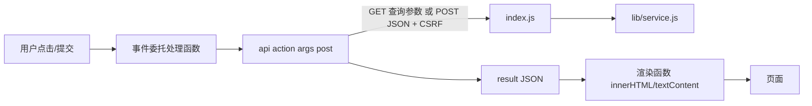

# `templates/cf_training_app.html`：浏览器端交互脚本

对应源码：[templates/cf_training_app.html](../../../templates/cf_training_app.html)

## 1. 它解决什么问题

这是整个页面"动起来"的部分：学生在页面上看到的数据、点按钮发起的操作、弹出的确认框、画出的图表，全部由这份脚本控制。它是一段立即执行函数（IIFE，`(() => { ... })()`），页面加载完成后立刻运行一次；之后靠事件监听响应用户操作。

它**没有构建步骤**、不引入任何框架：纯浏览器原生 JavaScript（`fetch`、`document`、事件监听），插在 `<script>` 标签里由 Hydro 一起发给浏览器。

## 2. 它在项目中的位置

- 运行位置：**浏览器**（学生的电脑）。它不能直接读写数据库，所有数据都要通过 HTTP 接口向服务器要。
- 被谁加载：[cf_training.html](cf_training.html.md) 最后一行 ``；模板变量 `cfCoach`/`cfToken` 由 [index.js](../../../index.js) 提供，脚本从页面根元素 `data-*` 属性读取。
- 它调用谁：`api()` → [index.js](../../../index.js) 的路由 → [lib/service.js](../lib/service.js.md)。它**从不**直接引用 `lib/` 下任何文件。
- 它操作谁：`cf_training.html` 里的元素（通过 `ct-` 前缀的 `id`）与页面上的弹窗。

## 3. 数据怎样经过它



### 唯一的数据出口：`api()`（第 23 行）

```js
const response = await fetch(url, post ? { method:'POST', credentials:'same-origin',
  headers:{ 'Content-Type':'application/json', 'x-cf-training-csrf':root.dataset.token },
  body:JSON.stringify({ action, ...args }) } : { credentials:'same-origin' });
```

- GET：`action` 与参数放进查询串；POST：放进 JSON 请求体，并带 CSRF 头。
- HTTP 非 2xx（如 403）抛"请求失败（状态码）"；JSON 里 `ok: false` 抛服务器给的 `error`。
- 返回 `body.result`，调用方拿到业务数据。

### 页面主数据：`refresh()`（第 530 行）

调 `api('dashboard')` 后，把结果写进全局变量 `data`，再渲染：

| 渲染目标 | 内容 |
| --- | --- |
| `#ct-account` | 学生：handle、教练确认状态、同步进度、本地 Rating、起点说明 |
| `#ct-runs` | 训练列表（含"查看"按钮） |
| `#ct-students` / `#ct-jobs` | 教练：学生表格与后台任务 |
| `#ct-ledger` | Rating 历史表 |
| `renderClasses()` | 班级选择器与班级榜 |
| `renderRating()` / `loadProblems()` / `loadProblemStats()` | 学生：成长曲线、题目记录、统计图 |

`data.isCoach` 与页面渲染时的 `data-coach` 不一致时，脚本会跳转回通用入口——处理"权限刚被撤销"的情况。

### 训练详情：`openRun(id)`（第 553 行）

取 `api('run', { id })`，按身份与状态渲染：赛前显示"题目将在开赛后显示"；教练看到换题表单、练习资格勾选、接触证据纠正、发布/结算按钮；学生看到签到按钮与本人状态说明。

### 防乱序（这段代码的关键设计）

页面里多个请求可能乱序返回（例如快速切换题目分类、快速打开两场训练）。脚本用"序号"解决：

| 序号变量 | 保护的对象 |
| --- | --- |
| `refreshSeq` | 主页数据刷新 |
| `runSeq` | 训练详情（切换训练后旧响应被丢弃，`currentRun` 也置空，避免写错对象） |
| `discoverySeq` + `discoveryCurrent(...)` | 选赛筛选与翻页（并绑定当时的班级，见 `invalidateDiscovery`） |
| `problemsSeq` / `problemStatsSeq` | 题目列表与统计图 |
| `classSeq` | 班级榜 |

规律：发起请求前 `++seq` 并记下参数，响应回来后先比较"序号与参数是否仍是当前的"，不是就丢弃。

### 其他值得知道的位置

| 位置 | 作用 |
| --- | --- |
| 第 1–10 行 | 根元素、`$()` 简化查询、`esc()` 转义、状态/任务名称的中文映射 |
| 第 69–204 行 | Rating 成长曲线：`renderRating`（统计头）、`drawRatingChart`（SVG 折线、段位色带）、悬停提示 |
| 第 215–246 行 | `loadProblems`：题目记录列表与分类切换 |
| 第 253–400 行 | `loadProblemStats` + 柱状图/环图绘制与键盘提示 |
| 第 401–477 行 | 班级偏好记忆（localStorage）、班级榜加载、`renderClasses` |
| 第 480–529 行 | 班级弹窗（新建/批量添加/转让）、成员移除 |
| 第 594–612 行 | `discover`：选赛筛选与翻页渲染 |
| 第 614–709 行 | 事件委托：`change`、`click`（含 `data-action`、`data-preview`、`data-commit` 等分支）、`keydown`、`resize` |
| 第 710–759 行 | `submit` 委托：绑定、自报、班级表单、导入、创建、换题、改期等 |
| 第 760 行 | 启动：`guarded(refresh)` |

## 4. 源码怎么读

建议不要从第一行顺序读到尾，而是按"用户故事"跳读：

1. 读 `api`（23）、`refresh`（530）、`openRun`（553），建立闭环。
2. 想改某个按钮：在 `root.addEventListener('click', ...)`（642）或 `submit`（710）里搜 `b.dataset.xxx` / `f.id === '...'`，找到它调用的 action 名。
3. 想看渲染格式：搜 `$('区域名').innerHTML`。
4. 想理解防乱序：搜 `Seq` 与 `Current`。
5. 想理解安全：搜 `esc(`——所有插入 HTML 的动态内容都应被它包住。审计文字、handle、错误消息也不例外。

## 5. 怎样使用或验证

- 不能单独打开：它的 `root.dataset.api` 需要模板渲染结果，直接双击文件会报"找不到元素/接口"。
- 本地浏览器回归（不需要 Hydro，需要本机 Edge 与可加载的 Playwright）：

```sh
node test/e2e/ui.cjs            # 主页、题目、统计、班级、Rating 计算中/失败/恢复
node test/e2e/classes.cjs       # 班级授权、转让、手机布局
node test/e2e/discovery.cjs     # 选赛切班与乱序保护
node test/e2e/exposure.cjs      # 接触证据纠正表单
node test/e2e/student-response.cjs  # 学生视角赛前隐藏/赛中链接
node test/e2e/draft-lifecycle.cjs   # 草稿改期/取消
node test/e2e/run-race.cjs      # 切换训练时写入目标不串场
```

这些脚本用真实模板 + 构造响应，不访问真实账号或数据库；它们证明页面逻辑，不能替代真实 Hydro 验收。详见 [test/e2e/README.md](../test/e2e/README.md)。
- 真实服务验证：独立 Hydro 容器中的 `test/e2e/release.cjs`，见 [test/e2e/release.cjs.md](../test/e2e/release.cjs.md)。

## 6. 容易误解的地方

- **它不能决定"能不能"**：按钮禁用只是提示；服务器会再次校验权限、状态和 token。绕过页面直接调接口也会被拒。
- **`data-tab` 切换只是显示 / 隐藏**：不触发重新加载；数据靠 `refresh()` 和各 `load*()` 函数。
- **`currentRun` 可能为空**：`tab()` 离开详情页时清空它，防止用户看不到详情时误发写操作；新增详情页按钮时要沿用这个检查。
- **API 结果不会自动刷新**：多数写操作成功后代码会再调 `refresh()` 或 `openRun()`；写新操作时别忘了。
- **不要直接把后端文案拼进 HTML**：默认都经过 `esc()`；只有明确是数字/受控枚举的字段可以例外（如 `r.id`、`x.rank`）。
- **改按钮的 `data-*` 名称要同步测试**：`test/e2e/*.cjs` 大量使用这些选择器。

返回上一级：[`templates/` 目录导航](README.md)。
