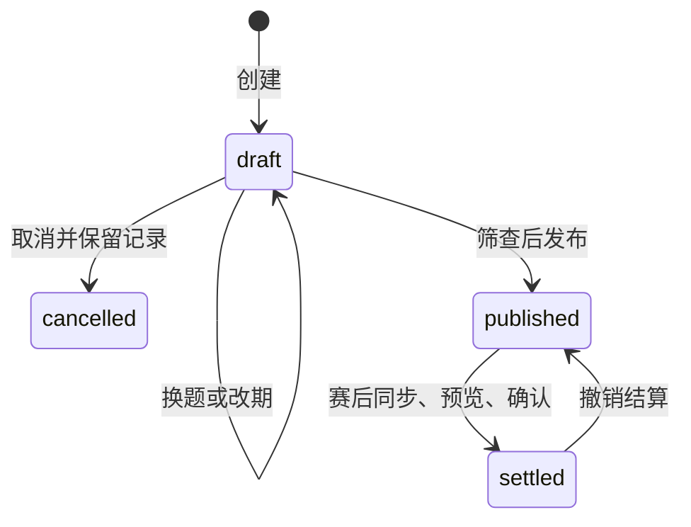
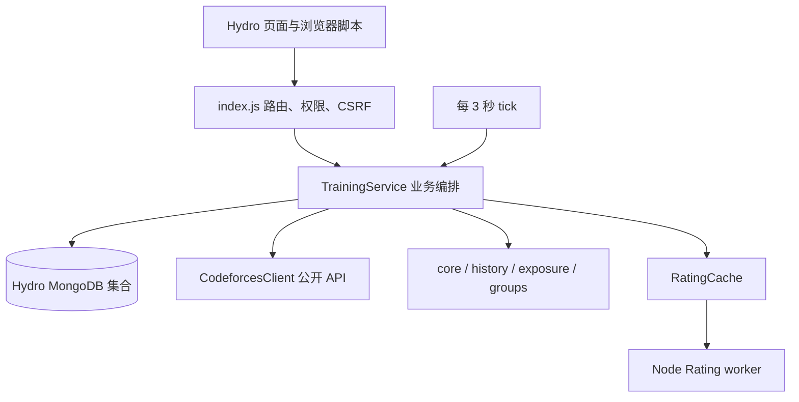

# Hydro CF 训练插件接手指南

这份文档面向第一次维护插件的开发者和运维人员：先理解它替老师和学生做什么，再找到对应代码、测试与部署入口。具体页面操作见 [README](../README.md)，部署恢复命令见[部署与恢复](deployment-recovery.md)。

本文于 2026-09-26 根据当前工作树代码整理（AI 补充）；未读取学生学习笔记。版本以 [package.json](../package.json) 为准，目前是 `1.0.0-preview.2`。下文的历史验收情况来自仓库记录，不代表本次重新完成环境验收。

## 1. 插件解决什么问题

老师想用一场已经结束的 Codeforces 比赛组织统一训练：先检查班内学生是否接触过题目，必要时换题，再按统一时间统计成绩，形成可撤销、可重算的本地训练 Rating。

学生仍在 Codeforces（下文简称 CF）阅读题目、提交代码和接受评测。Hydro 提供登录身份、域、权限、页面和数据库；插件负责账号绑定、班级、组赛、公开提交同步、资格判断、榜单及本地评分。它不会代替学生提交，也不修改 CF 官方 Rating 或 Hydro 自带积分。

当前实现历史比赛模拟，支持 CF 与 ICPC 计分。换题继承原题位置的基础分；题目难度接近不保证评分等价。IOI、Gym 组赛和特殊赛制不在当前支持范围内，不过学生历史统计可以包含可识别的 Gym 提交。

## 2. 先分清几个概念

| 概念 | 在本项目中的含义 |
| --- | --- |
| Hydro 域 / `domainId` | 业务隔离范围。同一学生在不同域的绑定和训练档案分别维护；同域多个班级共用个人本地 Rating。公开题库和历史参照数据可共用。 |
| Hydro UID | 本站用户身份。权限取当前登录用户，不能用请求中的 UID 冒充。 |
| CF handle / `bindingId` | handle 是远端账号名；`bindingId` 是本次绑定的内部标识。提交与训练成员引用绑定标识，防止换绑后混入旧账号记录。 |
| `verified` / `approved` | 前者表示同步确认远端账号存在；后者表示教练确认归属。仅查到一个 CF 账号不能证明它属于该学生。 |
| 训练班级 / `group` | 当前学生名单及所有者、管理员。创建训练时保存成员快照，之后改班级名单不追溯改变已有训练。 |
| 训练 / `run` | Hydro 中的一场训练实例，包含统一起止时间、成员、题目、规则和签到。不同于 CF 原比赛。 |
| 历史参照快照 / `snapshot` | 导入原赛时冻结的参照数据，使用公开原榜与 ratingChanges 的交集。后续重新导入不改变旧训练引用的快照。 |
| 接触证据 / `exposureEvidence` | 公开提交、参赛记录和自报等可核实事实。任何 verdict 的赛前提交都可能构成接触，不限 AC。 |
| 扫描证明 / `scanProofs` | 一次成功同步实际扫描到了哪里、何时开始、对应哪个绑定与代次。用于证明结算前已重新检查完整比赛窗口。 |
| 结算记录 / `ledger` | 保存有效评分输入、参照快照及冻结成绩的记录；撤销后该场不再参与 Rating 重算。操作历史另见 `audit`。 |
| 本地训练 Rating | 插件根据固定起点和有效结算计算的个人评分，是模拟估计。与 CF 官方个人 Rating、题目难度 Rating 分别理解。 |

“无已知接触记录”只表示目前可用证据未发现接触，不能证明学生从未看过题。历史不完整、过期或失败为“未知”，不能当成没有接触。已解决题目统计也只说明同步记录中有 AC，不能证明独立掌握。

## 3. 用一场训练串起系统

1. **绑定与确认。** 学生绑定 handle，后台验证账号并分页同步公开历史。教练确认归属后才能把该账号用于创建训练。首次同步取得的 CF Rating 保存为固定起点，无 Rating 时使用带来源标记的 1400；后续同步和换绑不重置它。已有旧结算的迁移起点沿用 1400。
2. **选择班级与原赛。** 教练同步比赛/题库，选择自己有权管理的班级，筛查候选比赛，再导入原赛参照榜。题库同步与参照榜导入是不同任务；只有列表数据还不能创建草稿。
3. **创建、调整、发布。** 创建草稿时冻结成员绑定和参照快照。草稿可换题、改到未来时间或取消。发布时重新筛查；计分训练要求所有成员的账号已确认且历史满足新鲜度要求。发布后锁定题目和计分配置。
4. **签到与参赛。** 学生签到，开赛后取得实际题目链接，在 CF 提交。统计窗口由 Hydro 的统一起止时间决定，学生自己开 CF Virtual 不改变窗口。
5. **同步与预览。** 赛后教练点击“同步本场所有学生”，等待覆盖整个比赛窗口的扫描完成，再预览成绩与 Rating。后台评分未完成时没有可确认 token。
6. **确认与纠错。** 确认结算时服务端重新生成预览、核对 token 和档案版本，保存冻结成绩。发现重测或资格错误时先撤销，修正后重新完整同步、预览、结算；后续 Rating 随有效记录重算。

训练状态只有四种；“赛前、赛中、赛后”由时间判断，并不是额外持久状态：



缺席、接触过题目或被设为练习的学生不更新 Rating；符合资格、已签到但零解题的学生仍参与评分。已签到成员的同步完备性与是否有 Rating 资格分别检查，不能因“不计分”就省去结算所需的扫描。

## 4. 程序如何运行

这是由 Hydro 加载的 CommonJS 插件，没有独立 Web 服务、`npm start` 或前端构建步骤。`index.js` 导出 `apply(ctx)`：注册权限，创建并初始化 `TrainingService`，注册路由和导航，再每 3 秒触发一次后台 `tick()`。卸载时清理定时器和 Rating worker。



有两种后台工作，不要混淆：

- **CF 同步队列**保存在 MongoDB。`tick()` 通过共享锁协调 Hydro 多进程，执行 `catalog`（题库）、`import`（参照榜）、`sync`（学生历史）任务。分页、代次和任务租约支持重启续跑；失败任务记录错误，排除原因后手动重试。CF 客户端串行请求，默认至少间隔 2.1 秒，20 秒超时，最多尝试 3 次。
- **Rating 计算队列**位于各 Hydro 进程内，由 Node worker 执行计算。每个缓存实例一次运行一个任务，相同评分版本合并请求；重启后按数据库中的权威输入重建。它没有独立数据库集合，也不是持久化同步队列。

日常账号刷新间隔为 6 小时，开赛前 10 分钟至赛后 1 小时使用约 60 秒的到期条件；调度器每 15 秒检查到期账号。队列和 CF 限速会增加实际延迟，这些间隔不是页面实时更新承诺。

## 5. 读代码从哪里开始

| 文件 | 职责与建议定位点 |
| --- | --- |
| [index.js](../index.js) | Hydro 集成及 HTTP 边界。看 `apply`、`TrainingApi.get/post`；创建、发布、撤销等部分操作直接在这里调用 `service.change()`。 |
| [lib/service.js](../lib/service.js) | 数据访问与业务编排。按 `bind → queueSync/syncPage → importContest → result → preview/settle` 阅读；调度在 `scheduleDueSyncs/tick`。 |
| [lib/core.js](../lib/core.js) | 输入校验、计分、排名、接触索引及 Rating 算法。与规则有关的修改从这里核对。 |
| [lib/cf.js](../lib/cf.js) | CF API 方法白名单、串行限速、超时和重试。 |
| [lib/history.js](../lib/history.js) | 提交历史按题去重、已通过/尝试过分类及分页；统计组装另在 service 中。 |
| [lib/exposure.js](../lib/exposure.js) | 接触证据采集与留存、旧发布快照兼容、误报纠正覆盖。 |
| [lib/groups.js](../lib/groups.js) | 班级可见性、所有权、管理员、转让与成员变更。 |
| [lib/permissions.js](../lib/permissions.js) | 注册独立教练权限，使用 BigInt 第 100 位并检查冲突。不要随意换位，否则旧授权失效。 |
| [lib/student-response.js](../lib/student-response.js) | 学生训练详情的字段白名单；赛前隐藏题目，隔离内部诊断与他人资格信息。 |
| [lib/rating.js](../lib/rating.js)、[worker](../lib/rating-worker.js) | 评分版本键、缓存、任务合并及后台重放。 |
| [templates/cf_training.html](../templates/cf_training.html) | Hydro 页面外壳、CSS 和模板数据入口。 |
| [templates/cf_training_app.html](../templates/cf_training_app.html) | 浏览器端请求、视图和图表逻辑；前端行为修改主要在此。 |
| [locales/zh.yaml](../locales/zh.yaml)、[en.yaml](../locales/en.yaml) | 导航和权限等翻译项；页面文案也存在于模板内。 |
| [scripts/package.cjs](../scripts/package.cjs) | 候选包文件清单、tar、逐文件 manifest 和 SHA-256。新增交付文档需检查这里是否收录。 |
| [scripts/deploy.ps1](../scripts/deploy.ps1)、[deployment.cjs](../scripts/deployment.cjs) | 部署入口、静态检查、停机切换、健康探测和代码回退。 |

## 6. 数据在哪里，哪些不能丢

插件使用六个**逻辑集合名**，实际物理名受 Hydro 的 prefix 和 collectionMap 影响。运维时用 [storage-manifest.cjs](../scripts/storage-manifest.cjs) 读取真实映射，不能直接猜集合名。

| 逻辑集合 | 保存内容 |
| --- | --- |
| `cftrain_state` | 每域一份档案：账号、班级、训练、个人自报、固定 Rating 起点、结算和审计；账号内还包含同步请求、分页状态与扫描证明。 |
| `cftrain_submission` | 以 `bindingId + 提交 ID` 标识的提交记录，包含 verdict、同步代次和尝试编号。 |
| `cftrain_catalog` | 公开比赛、题库、同步元数据及当前导入快照指针。 |
| `cftrain_reference` | 导入时冻结的参照快照元数据和分片。旧结算重放依赖这些数据。 |
| `cftrain_job` | 持久化后台任务、状态、错误、分页请求与租约。 |
| `cftrain_lock` | 多进程后台 worker 的协调锁。 |

`TrainingService.change()` 使用 `revision` 做乐观并发控制：读取档案，修改副本，再只替换仍为该版本的文档，冲突时有限重试。修改域档案应沿用此入口；回调可能重跑，不应在里面新增不可重复的外部副作用。这是单文档原子更新，不是跨六集合事务。

当前每班最多 100 人、每域最多保留 200 场训练；取消草稿也占场次数。档案序列化超过 12,000,000 字节会拒绝写入。自动归档尚未实现，不能把页面导出当成清库或删除旧记录的依据。

## 7. 维护时必须保住的业务约束

### 权限和返回数据

登录用户访问 `/cf-training` 时按域权限跳到学生或教练页；API 位于 `/cf-training/api`，用 `action` 区分操作。前端应使用 Hydro 模板生成的 URL，以保留域上下文。

教练资格只看独立的 `PERM_CF_TRAINING_COACH`，普通比赛编辑权限不够。班级所有者、班级管理员是单班授权，普通学生也可拥有；这些身份不会自动赋予组赛、账号确认或结算权限。域管理员通过 `PERM_EDIT_DOMAIN` 管理全部班级。选赛和创建还要检查教练是否有权管理所选班级，不能仅检查“是教练”。

GET/POST 都检查登录与域；POST 还校验会话中的 `x-cf-training-csrf`。业务结果通常为 `{ ok: true, result }` 或 `{ ok: false, error }`，权限错误交给 Hydro 返回拒绝响应。部署用 `/cf-training/health` 另需安装密钥，不是公共业务 API。

学生训练详情必须经过 `studentRunResponse()`。新增字段时在白名单中明确选择可公开字段，不能直接展开完整 run、成员档案或内部快照。仅在浏览器里隐藏字段不能防止泄露。

### 同步和结算

`historyComplete` 或“最近同步成功”不等于这场训练可以结算。需要与成员绑定一致、在比赛结束后启动、实际覆盖至开赛时间或历史末尾的成功扫描；撤销后要再取得撤销后的扫描证明。有待处理同步或待评测提交时也不能确认。

`syncGeneration` 区分扫描请求，`syncAttempt` 区分执行尝试，`cycle` 保存分页位置。旧请求和失败重试不能覆盖新提交状态，也不能缩短尚未满足的扫描范围。维护这部分时同时看结算覆盖测试，避免只修“同步按钮能用”。

预览 token 绑定当时的成绩、资格、扫描依据和档案 revision。预览后同步、纠正资格或其他档案变化可能使 token 失效，此时必须重新预览。不要为了消除提示而跳过确认校验。

### 接触证据和 Rating

删除个人“已见过”标记不删除已发布训练保留的证据。误报必须由教练选择具体证据、填写理由并留下审计；纠正不自动覆盖以后发现的新证据。已结算训练先撤销才能纠正。

本地 Rating 从固定起点出发，按有效结算的结束时间排序重放。每名学生分别插入同一原赛参照池，不把整个班一起加入原榜。撤销早期结算会影响后续评分，“有效训练历史最高”也可能下降。

评分缓存按有效输入生成版本键，普通同步状态或班名变化不等于评分输入变化。客户端须处理 `computing`、`busy`、`failed`、`ready`，未就绪不能显示旧结果为最新值，也不能确认没有 token 的预览。

## 8. 第一次在本地验证

先在插件目录确认 Node.js 版本，`package.json` 要求 Node ≥ 22、Hydro `>=5.0.0 <6`。这是声明范围，不代表所有 Hydro 5.x 版本都经过验证；已有运行时记录主要针对 Hydro 5.0.7。

```sh
node --version
npm test
```

默认测试命令是 Node 自带的 `node --test test/*.test.js`。纯逻辑与使用替身的测试不需要启动 Hydro；未提供外部环境时，相关测试明确跳过。不要把“0 失败”单独写成全环境验收通过，应一起记录通过、失败和跳过数。

| 改动范围 | 优先验证 |
| --- | --- |
| 计分、接触、历史聚合 | `core.test.js`、`history.test.js`、`problem-stats.test.js` |
| 同步、结算、并发 | `integration.test.js`、`settlement-coverage.test.js`、`discovery-scheduler.test.js` |
| 权限、学生可见数据 | `permissions.test.js`、`groups.test.js`、模板回归 `student-response.cjs` / `classes.cjs` |
| 资格纠正、草稿生命周期 | `exposure-evidence.test.js`、`draft-lifecycle.test.js` 及同主题模板回归 |
| Rating 重算、缓存、峰值 | `rating-computation.test.js`、`rating-peak.test.js`；性能对照另用 `bench-rating.cjs` |
| 打包、部署、恢复 | `package.test.js`、`deployment.test.js`、`database-recovery.test.js` |

表中 `.test.js` 均位于 `test/`；模板回归位于 `test/e2e/`。完整环境配置与命令以 [E2E 说明](../test/e2e/README.md) 为准：

- `CFTRAIN_TEST_MONGO_URL` 启用真实 Mongo 临时库测试；驱动需可加载，Hydro 容器通常通过 `NODE_PATH` 提供。
- `CFTRAIN_LIVE_TEST=1` 启用真实 CF API 测试，需要可访问远端。
- 模板浏览器回归需要 Edge 和可加载的 Playwright，使用构造响应，不代表真实 Hydro HTTP 已通过。
- `CFTRAIN_DEPLOY_RUNTIME=1` 启用 Hydro 运行时校验；完整 HTTP、重启、部署恢复另有隔离环境脚本，不能在普通开发验证时直接指向真实实例。

## 9. 打包、部署与恢复入口

本地打包可指定一个新的输出目录：

```sh
node scripts/package.cjs --list
node scripts/package.cjs /tmp/cf-training-candidate
```

脚本生成版本命名的 `.tar`、`.manifest.json` 和 `.sha256`，已存在同名候选时拒绝覆盖。验收对象应是同一个包的全新解包目录；源码或文档变动后，旧包哈希只代表旧候选，不能沿用为当前工作树的验证证据。

实际安装使用 PowerShell 7 的 `scripts/deploy.ps1`，显式指定获准容器。它依赖既有 WSL/Docker/Hydro 部署环境，不是通用的一键安装 Hydro 工具。操作前按[部署与恢复](deployment-recovery.md)完成备份和兼容性检查；该文档是恢复步骤的唯一详细入口。

代码回退、数据库恢复和页面 JSON 导出是三件不同的事。JSON 导出缺少全量提交和参照池；代码备份不能恢复业务数据。离线数据库备份要求停止所有写入者，恢复工具先导入独立随机库核对，不自动覆盖原库。跨恢复 epoch 或缺少兼容标记的旧版本不能直接套用普通代码回退。

真实内测试训的账号、成绩和 Rating 要保留到后续版本；只有明确标记的测试训练可清理。

## 10. 出问题时先看哪里

| 现象 | 先检查什么 |
| --- | --- |
| 学生“已同步”但不能组赛 | 区分账号存在验证、教练归属确认、历史完整性和最近 24 小时的新鲜度；检查班级当前名单。 |
| 找到比赛却不能创建草稿 | 原赛参照榜是否已导入成功；仅同步比赛目录不够。查看 `import` 任务目标和错误。 |
| 同步一直不结束 | 看后台任务状态、目标、错误，账号 `cycle` 与请求代次，以及 Hydro 日志中的 `[cf-training]`；大量分页会受串行限速影响。不要直接改成 ready。 |
| 赛后提示扫描不足 | 使用“同步本场所有学生”，等待完成；核对证明的绑定、开始时间与覆盖下界。普通近期增量扫描可能不够。 |
| 删除自报后仍不具备资格 | 本场保留了已确认的接触证据；由教练核对具体证据，必要时走误报纠正。 |
| 结算提示预览已变化 | 重新预览并等待评分 ready；核对期间是否同步、调整资格或发生其他档案写入。 |
| Rating 暂时为空或计算中 | 看 `ratingStatus` / `ratingError`；等待重建再刷新，不能用 1400 或旧评分替代所有未知结果。 |
| 普通学生成为班级管理员后仍不能组赛 | 属于权限设计；班级授权不授予全域教练权限。 |
| 换绑被拒绝 | 是否仍参与 draft 或 published 训练；cancelled 草稿不会阻止换绑。 |
| 容量已满 | 核对场次数和档案大小，保留数据并安排归档方案；当前没有安全的一键清理实现。 |

## 11. 接手时的版本边界与后续阅读

当前是内部预览版。仓库的 preview.2 收尾记录报告：Windows Node 24、独立 MongoDB 8.2.6 环境中 88 项测试有 86 通过、2 跳过，七套构造模板回归通过。跳过项为真实 CF 和 Hydro 运行时；修复后候选还需独立 Hydro HTTP/目标运行时复验和真实小班整场试训。此前版本的通过记录不能替代这一轮。

按问题继续阅读：

- 页面操作、计分细节：[README](../README.md)。
- 版本变化：[CHANGELOG](../CHANGELOG.md)。
- 外部环境与 HTTP 验证：[E2E 说明](../test/e2e/README.md)。
- 数据备份、升级与回退：[部署与恢复](deployment-recovery.md)。
- 真实小班使用结果：[试训记录](release-trial.md)。

源码仓库另保留 `docs/reviews/1.0-preview-final-review-2026-09-26.md`（本轮修复及历史验证证据）、`docs/preview2-handoff.md`（外部验收交接）和 `docs/plans/v1.0-tasks/`（分阶段记录）；这些历史资料不在候选包中。先看当前代码和版本说明，再按需要查历史，不要把旧计划或旧测试数量当成当前状态。
